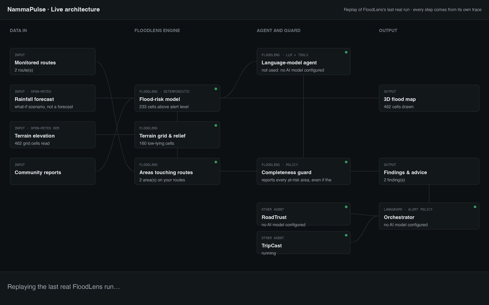

# NammaPulse

Your City, Watching Out for You. A personal urban infrastructure monitor for Bengaluru: agents watch the roads,
rainfall and terrain around your routes and tell you before you are affected.

Animated architecture: [docs/architecture_animated.mp4](docs/architecture_animated.mp4), rendered from a real FloodLens run by
`scripts/render_architecture_video.py`. The same animation runs live in the app's Architecture tab. Static picture: [docs/architecture.png](docs/architecture.png).

Walkthrough video: [docs/nammapulse-walkthrough.mp4](docs/nammapulse-walkthrough.mp4) (captured screens, not a screen recording).

| Part | Folder | What it does |
|---|---|---|
| FloodLens | `agents/floodlens` | Predicts flood-prone areas from real terrain and rainfall; 3D flood map |
| RoadTrust | `agents/roadtrust` | Road damage reports, duplicates, repair status, route relevance |
| TripCast | `agents/tripcast` | Trip time that accounts for traffic building while you travel; alternative roads |
| Orchestrator | `agents/orchestrator` | LangGraph graph: gather, dedupe, score, decide, with an auditable decision log |
| agentkit | `agents/agentkit` | Tool-calling LLM loop (Bob or OpenRouter), used when a key is configured |
| Web app | `apps/web` | 3D map, Trip, Alerts, Flood, Architecture and Agent tabs |

Honest status: scores and thresholds are uncalibrated starting values; the traffic pattern is an assumed curve unless a
TomTom key is set; no LLM runs unless `BOB_API_KEY` or `OPENROUTER_API_KEY` is set (agents then use fixed checks).
Copy `.env.example` to `.env` for settings; `.env` is git-ignored. Each agent folder has its own README and tests.

Run (one terminal each): see `apps/web/README.md`; FloodLens is
`uvicorn floodlens.api:create_app --factory --port 8005` from `agents/floodlens`.
